<!-- Reemplaza tu correo, tu LinkedIn y el enlace de tu portafolio -->

  
  
  
  

 

<h3 align="center"></h3>

  

 

<h3 align="center"></h3>

  

 

<h3 align="center"></h3>

  
  
  

  
  

  
  
  

 

<h3 align="center"></h3>

<!-- actividad.svg se actualiza solo cada día: .github/workflows/actividad.yml -->

  

