<!-- La carpeta claro/ es la versión para GitHub en tema claro; se regenera con: node .github/scripts/claro.mjs -->

<picture><source media="(prefers-color-scheme: light)" srcset="claro/banner.svg" /></picture>

  <a href="mailto:eimy319juliana@gmail.com"><picture><source media="(prefers-color-scheme: light)" srcset="claro/btn-correo.svg" /></picture></a>
  <a href="https://eimyruiz.github.io/Portafolio_EimyRuiz/"><picture><source media="(prefers-color-scheme: light)" srcset="claro/btn-portafolio.svg" /></picture></a>

 

<h3 align="center"><picture><source media="(prefers-color-scheme: light)" srcset="claro/titulo-sobre-mi.svg" /></picture></h3>

  <picture><source media="(prefers-color-scheme: light)" srcset="claro/sobre-mi.svg" /></picture>

 

<h3 align="center"><picture><source media="(prefers-color-scheme: light)" srcset="claro/titulo-stack.svg" /></picture></h3>

  <picture><source media="(prefers-color-scheme: light)" srcset="claro/stack.svg" /></picture>

 

<h3 align="center"><picture><source media="(prefers-color-scheme: light)" srcset="claro/titulo-proyectos.svg" /></picture></h3>

  <a href="https://github.com/EimyRuiz/Portafolio_EimyRuiz"><picture><source media="(prefers-color-scheme: light)" srcset="claro/proyecto-01.svg" /></picture></a>
  <a href="https://eimyruiz.github.io/Portafolio_EimyRuiz/"><picture><source media="(prefers-color-scheme: light)" srcset="claro/btn-pagina.svg" /></picture></a>
  <a href="https://github.com/EimyRuiz/Portafolio_EimyRuiz"><picture><source media="(prefers-color-scheme: light)" srcset="claro/btn-repo.svg" /></picture></a>

  <a href="https://github.com/EimyRuiz/EduCanSQlite"><picture><source media="(prefers-color-scheme: light)" srcset="claro/proyecto-02.svg" /></picture></a>
  <a href="https://eimyruiz.pythonanywhere.com/"><picture><source media="(prefers-color-scheme: light)" srcset="claro/btn-pagina.svg" /></picture></a>
  <a href="https://github.com/EimyRuiz/EduCanSQlite"><picture><source media="(prefers-color-scheme: light)" srcset="claro/btn-repo.svg" /></picture></a>

  <a href="https://github.com/EimyRuiz/Hi-Tramatic"><picture><source media="(prefers-color-scheme: light)" srcset="claro/proyecto-03.svg" /></picture></a>
  <a href="https://github.com/EimyRuiz/Hi-Tramatic"><picture><source media="(prefers-color-scheme: light)" srcset="claro/btn-repo.svg" /></picture></a>

  <a href="https://github.com/EimyRuiz/Hometecno"><picture><source media="(prefers-color-scheme: light)" srcset="claro/proyecto-04.svg" /></picture></a>
  <a href="https://github.com/EimyRuiz/Hometecno"><picture><source media="(prefers-color-scheme: light)" srcset="claro/btn-repo.svg" /></picture></a>

 

<h3 align="center"><picture><source media="(prefers-color-scheme: light)" srcset="claro/titulo-actividad.svg" /></picture></h3>

<!-- actividad.svg se actualiza solo cada día: .github/workflows/actividad.yml -->

  <picture><source media="(prefers-color-scheme: light)" srcset="claro/actividad.svg" /></picture>

