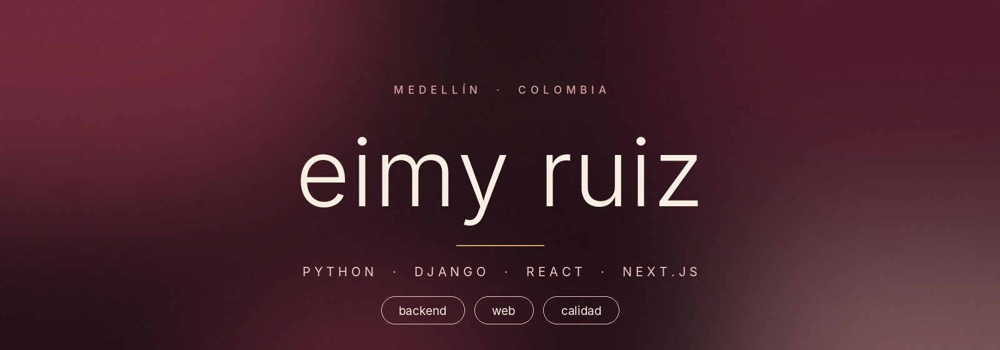

<!-- Reemplaza TU_USUARIO, tu correo, tu LinkedIn y el enlace de tu portafolio -->

  
  
  
  

 

<h3 align="center">Sobre mí</h3>

Aprendiz de Análisis y Desarrollo de Software en el SENA. 
Trabajo con Python y Django, y estoy sumando React, Next.js y Docker. 
Me gusta que lo que construyo funcione bien y se vea limpio.

 

<h3 align="center">Stack</h3>

  

 

<h3 align="center">Proyectos</h3>

<table align="center">
  <tr>
    <td align="center" width="340"><b>01 / HI-TRAMATIC</b> Web · Backend</td>
    <td align="center" width="340"><b>02 / EDUCAN</b> Web · Backend</td>
  </tr>
  <tr>
    <td align="center"><b>03 / ALQUIPC</b> Web</td>
    <td align="center"><b>04 / ALQUILER DE HABITACIONES</b> Web · Calidad</td>
  </tr>
  <tr>
    <td align="center"><b>05 / CALIDAD Y SEGURIDAD</b> Calidad</td>
    <td align="center"><b>06 / PASARELA DE PAGOS</b> Backend</td>
  </tr>
</table>

 

<h3 align="center">Actividad</h3>

  
  

  

